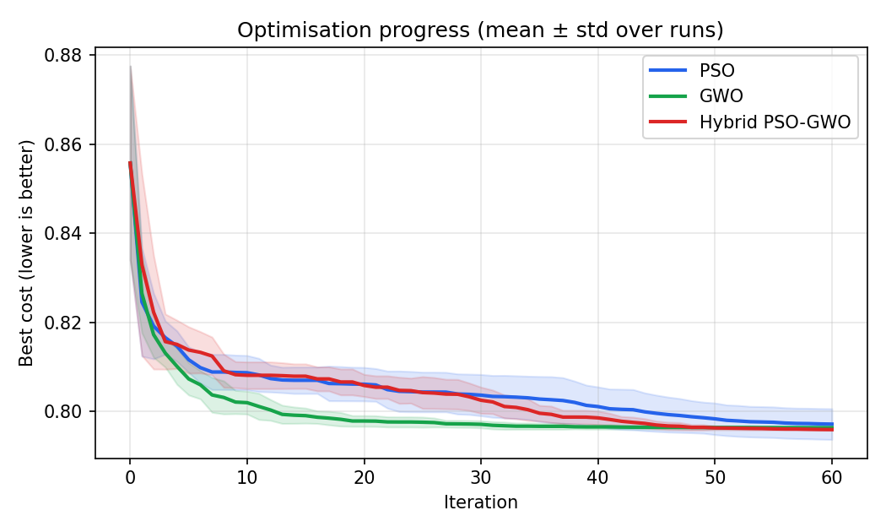
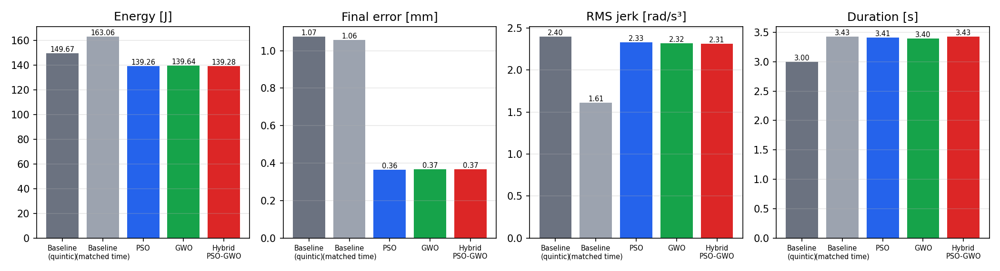
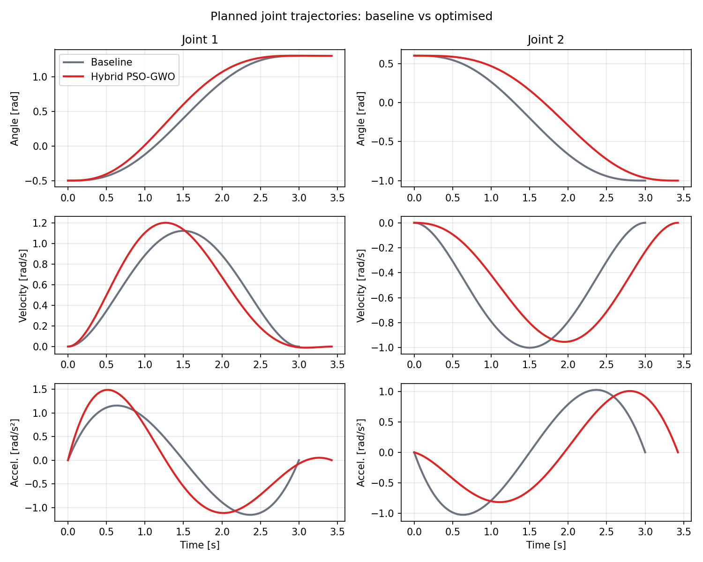
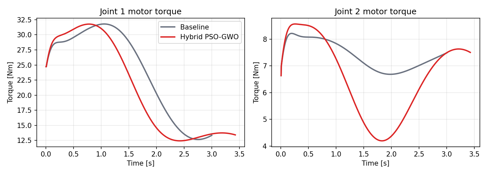
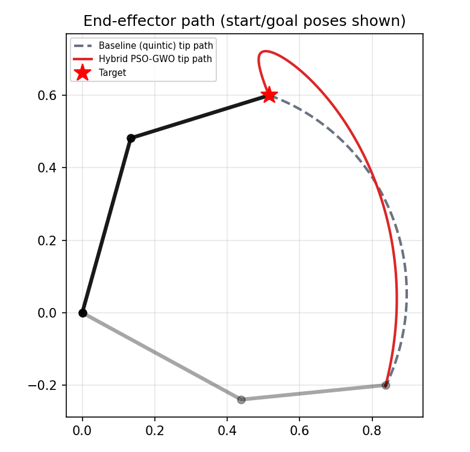
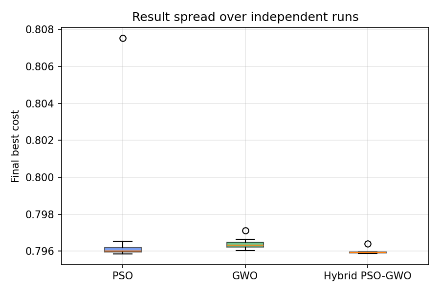

# Hybrid AI-Based Trajectory Optimization for Energy-Efficient Robotic Manipulator Control using PSO and GWO

*Auto-generated from the simulation run. Every number below was measured by `main.py`.*

## 1. Objective
Find a joint-space trajectory that moves a 2-DOF robotic arm from a start pose to a target pose with **low energy use, low positioning error, smooth motion and short duration**, while respecting joint angle, velocity, acceleration and torque limits. Three metaheuristics are compared: PSO, GWO and a hybrid PSO-GWO.

## 2. Method
**Robot.** 2-link planar arm in a vertical plane, full Lagrangian dynamics (link lengths 0.5 m / 0.4 m). Start joints [-0.5, 0.6] rad, goal [1.3, -1.0] rad, target tip position (0.516, 0.600) m.

**Trajectory parameterisation (7 decision variables).** Each joint = quintic polynomial (baseline) + 3 shape functions that vanish (with velocity and acceleration) at both ends, plus the motion duration T. The arm therefore always starts and stops at rest; the optimiser only reshapes the path between.

**Simulation / measurement.** Every candidate is run through a computed-torque + PID controller on a *plant that differs from the controller's model* (payload 1.0 kg vs 0.7 kg assumed, joint friction), with torque saturation. Energy and final position error are measured on this simulated plant, so they are not trivially zero.

**Energy estimate.** E = ∫ Σᵢ [ max(τᵢ·ωᵢ, 0) + R·τᵢ² ] dt, with R = 0.05 (positive mechanical work + copper loss; no energy recovery). It is a model-based *estimate*, not a hardware measurement.

**Cost.**  J = 0.5·E/E_ref + 0.2·err/5 mm + 0.15·jerk/jerk_ref + 0.15·T/3.0 s + 50·(constraint violation); E_ref and jerk_ref come from the baseline (T = 3 s quintic). The weights are a design choice and change the outcome.

**Algorithms** (identical budget: population 30 × 60 iterations, same initial population per seed, 10 independent runs).

* **PSO** – inertia 0.9→0.4, c1 = c2 = 2.
* **GWO** – alpha/beta/delta leaders, coefficient a: 2→0.
* **Hybrid PSO-GWO** – the three best personal bests act as GWO leaders; their guide points are averaged and replace PSO's global best: `v = w·v + c1·r1·(pbest − x) + c2·r2·(X_gwo − x)`. GWO gives wide exploration early, PSO gives momentum and memory for fine convergence.

## 3. Results

| Method | Energy [J] | vs baseline | Final error [mm] | RMS jerk [rad/s³] | Duration [s] | Cost | Cost mean ± std (runs) |
|---|---|---|---|---|---|---|---|
| Baseline (quintic) | 149.7 | +0.0% | 1.07 | 2.40 | 3.00 | 0.8430 | - |
| Baseline (matched time) | 163.1 | +8.9% | 1.06 | 1.61 | 3.43 | 0.8591 | - |
| PSO | 139.3 | -7.0% | 0.36 | 2.33 | 3.41 | 0.7959 | 0.7972±0.0035 |
| GWO | 139.6 | -6.7% | 0.37 | 2.32 | 3.40 | 0.7960 | 0.7964±0.0003 |
| Hybrid PSO-GWO | 139.3 | -6.9% | 0.37 | 2.31 | 3.43 | 0.7959 | 0.7960±0.0001 |

*The table shows the best run of each optimiser; the last column covers all runs.*








## 4. Discussion (generated from the numbers)

* **Energy.** The best optimiser by mean cost (Hybrid PSO-GWO) uses 139.3 J versus 149.7 J for the 3 s quintic baseline (-6.9%). To separate causes: running the *same quintic* at the optimised duration (3.43 s) increases energy by 13.4 J (to 163.1 J), and the optimised path *shape* then reduces it by a further 23.8 J (-14.6% relative to the matched-duration baseline).
* **Accuracy.** Final error 0.37 mm (baseline 1.07 mm, matched-time baseline 1.06 mm).
* **Smoothness.** RMS jerk is 2.31 vs 2.40 rad/s³ for the baseline (lower (smoother)); the optimised duration is 3.43 s vs 3.00 s. Smoothness, energy, accuracy and time are traded off through the cost weights, so a different weighting would give a different compromise.
* **Constraints.** All reported solutions have constraint violation = 0.000 (0 means every limit satisfied).
* **Algorithm ranking (mean cost, lower is better).** Hybrid PSO-GWO (0.7960 ± 0.0001) < GWO (0.7964 ± 0.0003) < PSO (0.7972 ± 0.0035). The hybrid method achieved the lowest mean cost (0.7960) over 10 independent runs. The gap between the three optimisers is of the same size as the run-to-run spread, so the ranking should be regarded as indicative, not conclusive. More runs would be needed for a statistical test.
* **Computation time per optimisation run:** PSO 15.6 s, GWO 15.8 s, Hybrid PSO-GWO 15.9 s.

## 5. Limitations
* Simulation only; a 2-DOF planar arm; the energy model is simplified and not validated on hardware.
* Results depend on the cost weights, the controller gains and the plant mismatch assumed.
* A single start/goal pair was tested; other motions or more DOFs may rank the algorithms differently.
* Hybrid design is one of many possible PSO-GWO combinations.

## 6. How to reproduce
```
pip install -r requirements.txt
python main.py            # full experiment (about 8-15 min on one CPU core)
python main.py --quick    # smoke test
```
